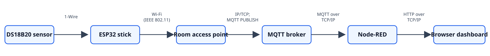

# Module 1

## Who am I?

### Programming experience?
    - experience in basic Python/Data Analysis and basic web design via html, css and javascript?
    - Django Framework, which combine all of the above

### Microcontroller?
    - worked a bit with Arduino and gyrosensors, transferring the sensor data per Arduino script to NodeRed and building an Interface in Node Red to visualize the data 

### Configured a router, set an IP adress by hand, run ping/traceroute?
    - ganz simpel den eigenen Heimrouter eingerichtet

### Used Wireshark, tcpdump, packet capture?
    - not yet

### MQTT, Python, NodeRed, command-line, Git?
    - Python, NodeRed
    - using terminals and git to organize projects

### What would you like to connect to what?
    - Aufbau einer smarten Steuerung von Licht und Heizung 

### What do you exect from this class?
    - afterwards being able to create my own network for various devices

## My pod
We are Jan and Sven
Jans repository:
[a link](https://github.com/JaGrHSBI/net-iot-hsbi-2026-portfolio/blob/main/README.md)

## Pre-study-artefact

### Show one artefact from Module 0
[a relative link](../PreStudy/pictures/Screenshot_mqttx.png)

### Explain one thing you understood only after doing it.
Dass die IP Adresse quasi Postadresse des Gerät ist, jedoch für unterschiedliche Anwendungen unterschedliche Adressen benutzt werden.

### Name one question you still have — we park them on the board and pick them up during the day.

## Warm up
### Name three devices in this room that are on a network. What does each one need before it can talk to another?
Laptop, Beamer und Repeater sind in diesem Raum angebracht. Damit Laptop und Beamer miteinander kommunizieren können, müssen sie mit demselben Netzwerk verbunden sein (direkt oder über den Repeater) und ein kompatibles Protokoll verwenden. Für Kommunikation über IP brauchen sie außerdem gültige IP-Adressen; bei Geräten in verschiedenen Netzwerken muss ein Router den Verkehr weiterleiten. Der Repeater muss korrekt mit dem Netzwerk verbunden sein und leitet Signale bzw. Daten weiter, benötigt aber nicht unbedingt eine eigene IP-Adresse.
### Why might a sensor's data take a round trip through the internet when the person reading it is in the same building?
The sensor may send its data to a cloud service or remote broker, and the reader's app retrieves it from there. This can happen because the system is designed around cloud storage or processing, or because the sensor and reader are on separate networks with no direct local route between them. Physical proximity does not guarantee a direct network connection.
### What is the difference between a layer and a protocol?
A layer is a conceptual level in a network model, grouping related responsibilities (for example, routing or reliable data delivery). A protocol is a defined set of rules used to communicate at a particular layer, such as IP for network addressing and routing or TCP for reliable transport. In short, a layer describes what kind of job is done; a protocol specifies how devices do it.

## study log
### Task 1: Study in your pod
[a link](https://github.com/JaGrHSBI/net-iot-hsbi-2026-portfolio/blob/main/Module01/README.md)

### Task 2: Explain & share with another pod
4. [a link](https://github.com/SebasAbt/net-iot-hsbi-2026-portfolio/blob/main/Module01/01-Foundation-and-Masterclass.md)
    Uns gefällt die klare gegenüberstellung der beiden Modelle OSI und TCP/IP

### Task 3: First contact — hello, Node-RED
Work through Phase 1 of the workshop workbook (connect to the room Wi-Fi, open your own Node-RED, inject → debug, “Hello IoT!”).
Portfolio evidence: a screenshot of inject → debug with the arriving payload, and one sentence naming publisher, broker, and subscriber.
Pictures:
[a link](https://github.com/JaGrHSBI/net-iot-hsbi-2026-portfolio/blob/main/Module01/pictures)
--Beschreibung der Datenverarbeiten--
[a link](https://github.com/JaGrHSBI/net-iot-hsbi-2026-portfolio/blob/main/Module01/README.md)

publisher stick
broker: nodered server?
subscriber: debug node?

### Task 4: Your stick answers — buttons, LED, screen
Work through Phase 2 (listen to <id>/home, toggle the onboard LED via <id>/led/set, print to the screen via <id>/console/set).
Pictures:
[a link](https://github.com/JaGrHSBI/net-iot-hsbi-2026-portfolio/blob/main/Module01/pictures)
--Beschreibung der Datenverarbeiten--
[a link](https://github.com/JaGrHSBI/net-iot-hsbi-2026-portfolio/blob/main/Module01/README.md)

### Task 5: The domino chain — the room becomes a network
Build Phase 3: your button press toggles your neighbour's LED (<neighbour-id>/led/set — the pod sitting next to you; the last pod wraps around to the first). Then pull the chain once with the whole room.
Pictures:
[a link](https://github.com/JaGrHSBI/net-iot-hsbi-2026-portfolio/blob/main/Module01/pictures)
--Beschreibung der Datenverarbeiten--
[a link](https://github.com/JaGrHSBI/net-iot-hsbi-2026-portfolio/blob/main/Module01/README.md)

### Task 6: A real sensor, and an OTA deploy
Connect the Dallas DS18B20 and run Phase 4. If your pod has the pre-soldered Grove protoboard, plug it into the Grove port — the sensor is on GPIO32, and the instructor uncomments ds18b20(temp, 32);. If you only have the bare sensor, wire DATA to G26 and the instructor uses ds18b20(temp, 26);. Either way the deploy goes over the air. Subscribe to <id>/temp.

### Task 7
**Concept — The control-room dashboard**
1. In Node-RED we´d add an MQTT input subscribed to `10/temp` and connect it to a gauge and a chart. Converting the incoming payload to a number if needed, then set useful temperature units, labels, and ranges so someone can understand the readings at a glance.
2. Add a second MQTT input subscribed to the wildcard topic `+/temp` and connect it to a chart configured to show multiple series. The `+` matches one topic level, so readings such as `10/temp` and `11/temp` appear together; label each series with its topic or sensor ID.
3. Deploy the flow, check that both nodes receive readings, and pinch the sensor to confirm that its temperature changes on the shared chart.

If each pod invented its own topic names, the common wildcard could not reliably collect every temperature reading. The flow would need separate subscriptions or custom mappings for each pod, and some sensors might be missed.

### Task 8
**Concept — What the layers cost**

1. **Get a capture safely.** We ask the instructor for the provided `module01.pcap` or a capture from the router/ESP32 tap. Our default is the router's `br-lan` capture filtered to TCP port 1883. We do not try to capture Wi-Fi radio traffic from our laptop because it does not have the required second adapter or monitor mode. We copy the supplied capture locally and note its source and capture interface.
2. **Find one sensor publish.** We open the file in Wireshark and use `mqtt` or `tcp.port == 1883` as the display filter. We find an MQTT `PUBLISH` carrying a temperature reading. If Wireshark is unavailable, we inspect it with `tshark -r module01.pcap -Y mqtt -V` or `tcpdump -r module01.pcap -A 'tcp port 1883'`. We record the topic, payload, QoS, and packet/frame number. We check that the selected TCP packet contains the complete MQTT message; if it is split across TCP segments, we use Wireshark's reassembled MQTT view rather than treating one segment as the whole publish.
3. **Measure each part from that same publish.** We record the captured frame length, link-layer header (Ethernet on a typical `br-lan` capture, or 802.11 if that is what the capture actually contains), IPv4 header, TCP header, MQTT fixed header, topic string, and payload. We read lengths in the packet details/bytes pane and use actual values because TCP options, VLAN tags, MQTT QoS, and the variable-length MQTT Remaining Length field can change header sizes. A router bridge capture usually does not include Wi-Fi radio headers or the Ethernet FCS, so we label the result as *captured frame bytes*, not the complete over-the-air frame.
4. **Check the byte arithmetic.** We make an overhead table whose components add up to the captured length. MQTT's Remaining Length field also describes variable-header and payload bytes, so we do not count it twice. We compute `overhead bytes = captured frame bytes - sensor payload bytes`, `overhead ratio = overhead bytes / sensor payload bytes`, and `payload share = sensor payload bytes / captured frame bytes × 100%`. We show the raw byte counts and results (ratio as a ratio or percentage) so someone else can reproduce them.
5. **Estimate battery life with explicit assumptions.** We look up the transmit current in the datasheet for the exact ESP32 variant and the capacity for the exact coin-cell model we would use; we cite both sources and record units. We state the reporting interval `N` seconds and assumed radio transmit duration `t` seconds per reading. We first estimate transmit charge per reading as `I_tx (mA) × t (s) / 3600` mAh, then daily transmit charge as that value times `86400 / N`, and estimated days as usable battery capacity (mAh) divided by daily charge. We state that this is a transmit-only estimate: Wi-Fi association, receive/listening time, sleep current, regulator losses, battery derating, and the coin cell's ability to supply ESP32 peak current can materially reduce real life. We do not present the arithmetic as a guaranteed runtime.
6. **Compare with an LLM, then verify.** Before inspecting exact sizes, we ask an LLM to predict the relevant link, IPv4, TCP, and MQTT header sizes and which values may vary. We record its predictions, then check every size against the selected packet. We note at least one error or explicitly say that its predictions matched this capture, and explain any difference using the capture point or options present.
7. **Save our evidence.** We include a screenshot or transcription of the selected PUBLISH, the overhead table and calculations, the cited ESP32 and battery assumptions, the estimated days, and one sentence on whether our measurement matched the LLM's explanation.

### Task 9 (optional)
**Concept — Cross the room, cross the internet**

We choose two short explorations: test what happens when our dashboard loses its connection, and then send one temperature topic to a public broker. We use only test readings and no personal information, names, or credentials.

1. **Make the dashboard fail gently.** Before disconnecting, we note the latest temperature and check whether Node-RED shows the MQTT connection status. We turn off Wi-Fi on the laptop running the dashboard, wait longer than one sensor update interval, and observe the gauge and chart. We record whether the values disappear, stay frozen, or show an explicit offline/stale warning. We reconnect and check whether fresh readings resume. We expect the dashboard may keep displaying the last value even though it is no longer current; a useful dashboard should make the loss of connection or age of the last update clear. Possible challenges include the laptop reconnecting automatically, an unclear Node-RED status indicator, or another device continuing to display cached data. We do not restart the broker or configure a Last Will for this test.
2. **Bridge one topic to the public internet.** We generate a random, non-identifying topic suffix and, with the instructor's help, configure the class system to forward only our temperature topic to `hsbi/<random-id>/room/temp` on `broker.hivemq.com`. We confirm that the bridge is forwarding the expected topic and no other class topics. On a phone with Wi-Fi turned off and mobile data enabled, we connect an MQTT client to the public broker and subscribe to that exact topic. We expect to receive temperature readings while the bridge is running. We record who could potentially see them: anyone able to connect to the public broker and subscribe to the topic, since the random topic name is not an access-control rule. To reach the private class broker directly from outside instead, we would need an intentionally configured and secured route into the private network (for example, a VPN), plus appropriate firewall and broker access controls; merely knowing its address or topic is not enough. Possible challenges include outbound network restrictions, incorrect bridge topic mapping, a phone still using Wi-Fi, or public-broker availability. We stop the bridge and unsubscribe when finished, then verify that new readings no longer arrive.
3. **Record our conclusion.** We write what we expected and observed for both explorations, note any challenge and how we resolved it, and include a screenshot or brief evidence of the dashboard status and phone subscription. We identify the stale-value behavior as a symptom to address later, not as a secure or reliable production design.

### Task 10 — Pitch the system we built

**Story Pitch**
At 06:40 on Monday, mill shift lead Tobias Kern finds the mill has been running cold since Saturday. A temperature-sensitive batch may be lost, putting the delivery and the night shift's work at risk. We attach the DS18B20 temperature sensor to our ESP32 stick and publish its reading. Node-RED turns those MQTT readings into a dashboard chart, so Tobias can see whether the temperature is changing. This is monitoring, not automatic control: Tobias still decides what to do when the reading is too low.

**Continuum sketch**

The broker and Node-RED may be software on the same class server; the sketch shows the message path, not necessarily separate computers.

**Weakest link:** If the room Wi-Fi/access point fails, the stick cannot publish fresh readings, so Node-RED stops receiving data and the dashboard may leave an old temperature on screen.

**Report sentence:** A small sensor lets Tobias see when the mill is getting too cold, giving him a chance to protect the batch before it is lost.

## Learning Goals

> **How to use the learning goals.** Copy the module's learning goals from the course workbook into the block below. Keep the `LG1`, `LG2`, … IDs and a one-word keyword. In each task, write `Proves: LG2` (or link to `[LG2](#lg2)`) so you can find the evidence quickly at checkpoint time. In the **Evidence** line under each goal, link to the task that proves it.

You can see the detailed achievements in the tasks above and in the respective Learning Goal section in Jans repository:
[a link](https://github.com/JaGrHSBI/net-iot-hsbi-2026-portfolio/blob/main/Module01/README.md)

## Reflection 1

[Reflection 1](../Reflections/ref01.md)
